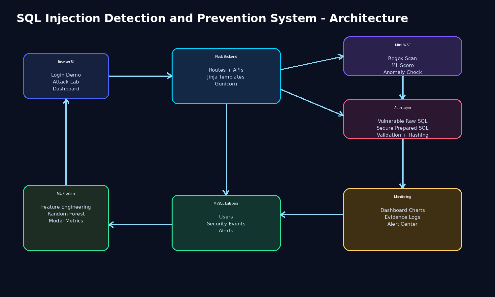
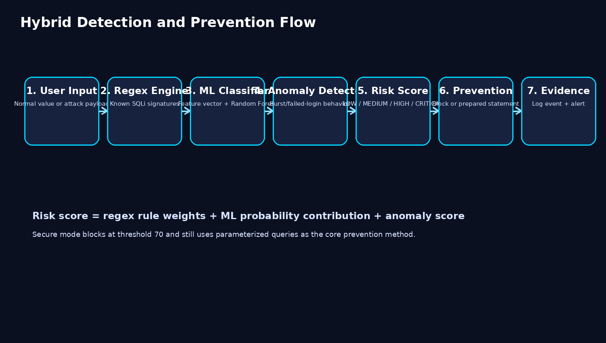
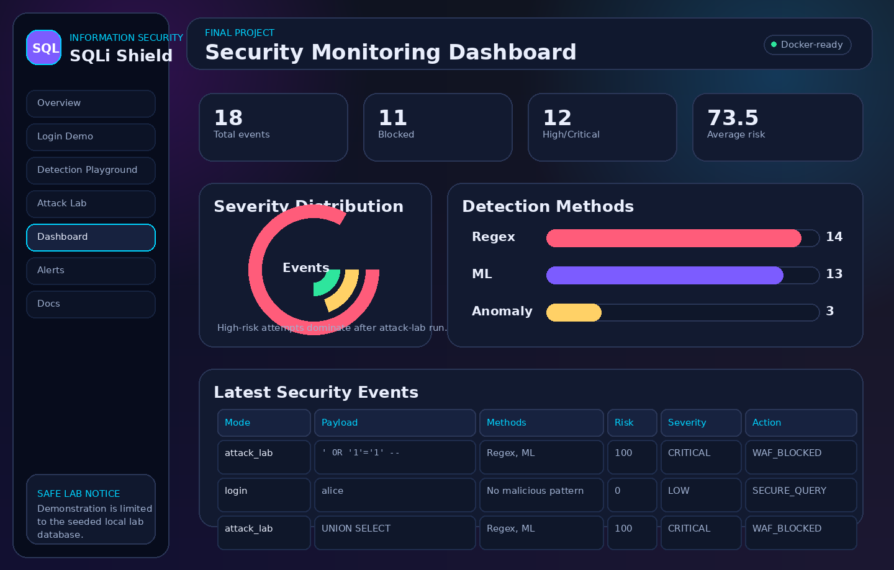
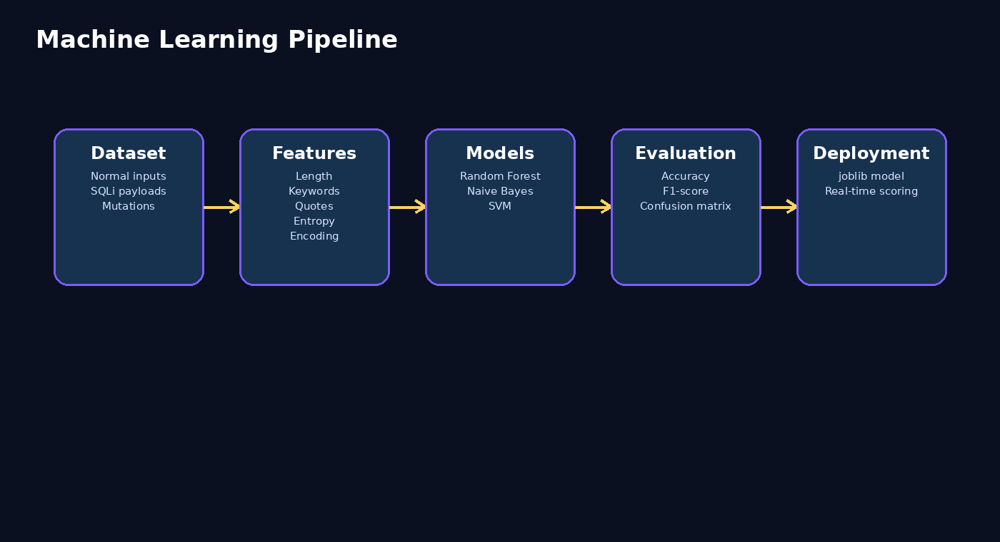

# SQL Injection Detection and Prevention System

> ## ⚠️ Educational lab — do not deploy publicly
>
> This repository contains an **intentionally vulnerable login route**, included
> so that an attack can be shown succeeding and then shown being blocked. It
> exists to demonstrate the vulnerability against this application's own seeded
> demo database, on an isolated machine.
>
> **The vulnerable route is disabled by default.** Enabling it (`ENABLE_VULNERABLE_DEMO=true`)
> on anything publicly reachable would expose a live injectable endpoint. Do not
> run these payloads against any system you do not own.

A defence-in-depth system that detects SQL injection three independent ways,
combines the verdicts into a single risk score, and blocks above a threshold —
with a live dashboard showing what it caught.



## The detection engine

No single detection method is sufficient. Signatures miss novel payloads,
a classifier miscalls things a rule would catch instantly, and neither sees an
attacker who is simply hammering the login form. So all three run, and their
outputs are combined.

### 1. Regex signatures — ten weighted attack families

| Family                        | Example                                | Weight |
| ----------------------------- | -------------------------------------- | ------ |
| Quote / comment tokens        | `admin' --`                            | 15–25  |
| Boolean tautology             | `' OR '1'='1'`                         | 35     |
| `UNION SELECT` extraction     | `' UNION SELECT username, ...`         | 40     |
| Destructive DDL               | `'; DROP TABLE users; --`              | 45     |
| Stacked queries               | `'; INSERT INTO ...`                   | 40     |
| `information_schema` recon    | `' UNION SELECT table_name FROM ...`   | 35     |
| Time-based blind              | `' OR sleep(5) --`                     | 40     |
| `xp_cmdshell`                 | OS command execution attempt           | 45     |
| Encoding obfuscation          | `%27 OR 1=1--`, hex, `CHAR()`          | 30     |
| Inline comment obfuscation    | `UN/**/ION SEL/**/ECT`                 | 30     |

Each rule carries a weight *and* an explanation, so a detection can be justified
rather than just asserted.

### 2. Machine learning — eight explainable features

A Random Forest over features chosen to be inspectable rather than opaque:
payload length, quote count, SQL keyword hits, encoded-pattern count, Shannon
entropy, tautology count, suspicious function count, comment tokens.

**Shannon entropy** is the interesting one: encoded and obfuscated payloads have
a markedly different character distribution from a normal username, so entropy
separates them without needing a signature for each encoding scheme.

### 3. Behavioural anomaly

Per-IP request rate and failed-login frequency. This is the layer that catches
what the other two structurally cannot: an attacker whose individual requests all
look benign but who is sending hundreds of them.

### Combining them

The three feed a **0–100 risk score** mapped to LOW / MEDIUM / HIGH / CRITICAL.
Mini-WAF middleware blocks at 70. Every decision is written to `SecurityEvent`,
and crossing the threshold raises an `Alert`.



## Prevention

The point of the project is the before/after. Two login routes exist over the
same data:

| Route      | Implementation                                                         |
| ---------- | ---------------------------------------------------------------------- |
| Vulnerable | Raw string concatenation into SQL — `' OR '1'='1' --` walks straight in |
| Secure     | SQLAlchemy bound parameters, Werkzeug password hashing, `^[A-Za-z0-9_]{3,30}$` username whitelist |

There is also a parameterisation-only mode with the WAF switched off, which
demonstrates the point that actually matters: **prepared statements defeat the
attack on their own**, because the payload is passed as a value and never parsed
as SQL. The WAF is defence in depth on top of that, not a substitute for it.

## What you can look at

| Page          | Shows                                                     |
| ------------- | --------------------------------------------------------- |
| `/login`      | Secure vs. vulnerable login, side by side                  |
| `/attack-lab` | The use-case matrix — each attack family, with outcomes    |
| `/playground` | Paste any payload and see the full detection breakdown     |
| `/dashboard`  | Live events, severity distribution, method attribution     |
| `/alerts`     | Generated high-risk alerts                                 |



## Running it

```bash
cp .env.example .env    # set SECRET_KEY, MYSQL_PASSWORD, MYSQL_ROOT_PASSWORD
docker compose up -d --build
```

Then open <http://localhost:5000>. Demo accounts are `admin` / `alice` / `bob`
with the passwords set in the seeder.

To see an attack succeed, set `ENABLE_VULNERABLE_DEMO=true` in `.env` — on an
isolated machine — and restart.

```bash
pytest          # detection engine, feature engineering and auth flow tests
docker compose down -v   # reset the database
```

## Model metrics, honestly

The classifier scores near-perfectly on its test split, and that number should
not be read as a claim about production performance. The training data is
synthetically generated with a known payload grammar, so the model is being
scored on the same distribution it was built from. **It is a proof of concept,
not a production-grade standalone detector** — which is precisely why it is one
of three layers rather than the whole system.

Full metrics are in `docs/ml_model_metrics.json`.



## Layout

```
app/
├── services/       detection_engine, ml_detector, anomaly_detector, auth_service, alert_service
├── templates/      Jinja pages
├── static/         CSS and JS, Chart.js dashboard
└── models/         trained Random Forest (joblib)
ml/                 dataset generation, feature engineering, training
tests/              pytest suite
docker/             entrypoint
docs/               architecture notes, security analysis, use cases, screenshots
```

Flask app factory with blueprints, service classes for each detection layer, and
environment-driven configuration throughout.

## References

OWASP SQL Injection Prevention Cheat Sheet, OWASP Top 10 A03 (Injection), OWASP
Query Parameterization Cheat Sheet, NIST SSDF, scikit-learn documentation.
